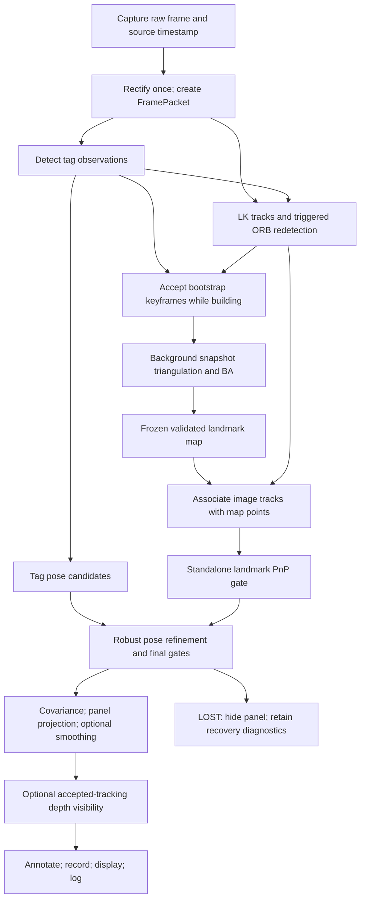

# sahaj_ar_projection: project context and engineering handover

Last verified: **19 October 2026, Australia/Sydney**.

This document records the current source, configuration, measured results, open
problems and proposed work. It separates observations from hypotheses. It is a
handover snapshot, not a claim that the planned system has passed acceptance.
Run-directory timestamps are UTC; local filesystem timestamps may be Sydney time.

## 1. Read this first

1. The application is a **video-see-through AR prototype**: a moving webcam views
   a virtual screen fixed in a mapped workspace. It renders into the webcam
   preview; it does not control a physical projector.
2. The virtual panel **already has metric 3D geometry**. Camera tracking and
   real-world occlusion are separate problems.
3. The active setup is the external Logitech camera, index `0`, backend `msmf`,
   resolution `640x480`, a separate Logitech calibration, and a **0.17 m tag**.
4. A valid Logitech landmark map **has now been built and saved**. Earlier notes
   saying that no Logitech map exists are historical.
5. Bundle-adjustment convergence improved after the user changed its hardcoded
   `x_scale` from `1.0` to `"jac"`. That change is present in the current source.
6. The main unresolved problem is **reliable localization against the saved
   natural-landmark map**, particularly without tag observations.
7. The completed comparison found only **17.8%** valid poses for the strongest
   landmark variant, against the initial **95%** target. Joint mode produced
   only tag poses in that comparison.
8. About **98% LK survival does not establish correct 2D-to-3D associations**.
   An additional reference-based check found many inconsistent map associations.
9. The immediate investigation should examine association identity lifetime,
   descriptor matching and map/view consistency. Loosening geometric thresholds
   or adding more landmarks is not yet supported as the primary solution.
10. **40 automated tests pass**, freshly verified for this snapshot. Sustained
    physical tag-hidden tracking, live performance acceptance and neural-depth
    occlusion quality have not passed or been demonstrated.

## 2. Goal, assumptions and acceptance criteria

### Intended behavior

The camera may translate and rotate. The anchor tag and mapped static background
stay fixed relative to each other. A virtual screen remains registered to that
workspace. When the tag is occluded by a hand, leaves the image, or becomes hard
to observe, mapped natural features should continue to support camera pose.

The tag supplies a recognizable anchor, a metric scale through its measured
size, and useful recovery observations. Scene landmarks extend usable coverage
beyond the tag and can constrain or reject inconsistent tag observations when
the landmark evidence is strong enough.

If both sources fail, the panel should disappear. The system should relocalize
when current evidence returns. Frozen poses or unsupported extrapolation do not
count as successful tracking.

After tracking is reliable, an optional RGB-depth prototype should determine
whether real objects lie in front of or behind the virtual panel and composite
accordingly. A dense scene mesh is not required for the first prototype.

### Physical assumptions

- The natural-landmark map is frozen after bootstrap; this is a static-scene
  localization system, not a continuously updating SLAM map.
- Moving the tag relative to the mapped scene invalidates their shared world
  relationship, even if file metadata still matches.
- Moving mapped objects can make their stored 3D coordinates invalid. Hands and
  people should not be trusted background landmarks during map creation.
- The calibrated camera mode, optics/focus/crop and actual image dimensions must
  remain appropriate. A matching calibration-file hash cannot detect a physical
  focus or camera-mode change.
- Tracking is required inside the mapped operating workspace. An unrestricted
  360-degree pan outside mapped coverage is not promised.

### Initial acceptance targets

| Area | Target | Current status |
|---|---|---|
| Tag-hidden availability | At least 95% evidence-supported valid poses during a two-minute test | Failed on the shorter controlled comparison; physical acceptance pending |
| Sustained use | Follow with five minutes of continuous tag-hidden use | Pending |
| Reference registration | Panel-corner disagreement under 5 px median and 10 px p95 | Met on successful samples of the landmark trials, not across lost frames |
| Recovery | Within one second after usable evidence returns | Not established; current recovery summary has a known caveat |
| Display rate | At least 20 displayed FPS | Latest evaluated live clip: about 15.67 FPS |
| Application latency | At most 100 ms p95 measured read-to-display submission time | Latest evaluated live clip: about 78 ms; excludes sensor/driver/monitor delays |
| No-evidence behavior | Hide panel and relocalize; do not count frozen or predicted poses | Implemented and synthetically tested |
| Initial occlusion quality | Visibility-mask IoU at least 0.85, with front/behind cases | Not measured on this laptop/scene |

The reference comparison is **agreement with a tag-derived pose**, not absolute
ground truth. Both methods depend on the same calibration and scene assumptions.

### Scope not yet implemented or validated

No full SLAM replacement, loop closure, automatic dynamic-object segmentation,
hand-specific mask, learned feature tracker, dense scene reconstruction or video
texture playback has been added. Video playback follows this prototype. Future
sports/badminton applications are not implemented by the current panel demo.

## 3. Workspace, runtime and important files

Workspace root:

```text
C:\Users\sahaj\OneDrive\Desktop\Uni_Resources\Year_4\AMME5710\Post-Game-AR\sahaj_ar_projection
```

Use PowerShell from this directory and invoke the project interpreter explicitly:

```powershell
.\.venv\Scripts\python.exe
```

Do not infer the interpreter from the `(base)` or `(.venv)` shell prompt, or run
the `.py` file through its Windows file association. Previous direct `.py`
invocations returned without running the intended environment.

Verified local versions:

| Component | Version/status |
|---|---|
| Python | 3.12.4; project targets Python 3.10+ |
| NumPy | 2.5.4 |
| OpenCV | 4.14.0, contrib/ArUco functionality |
| SciPy | 1.18.1 |
| Main environment | Existing `.venv` |
| PyTorch in main environment | Not installed at verification |
| `.venv-depth`, `models`, `third_party` | Not present at verification |

Normal requirements are NumPy, `opencv-contrib-python` and SciPy. Optional ML
requirements are isolated in [requirements-depth.txt][requirements-depth]. The
normal tracking path does not import PyTorch.

| File | Role |
|---|---|
| [april-tag-projection.py][entry] | Thin runtime entry point; enables native fault reporting |
| [calibrate-camera.py][calibrate-entry] | Thin calibration entry point |
| [config-logitech.json][logitech-config] | Active complete Logitech configuration |
| [config.json][default-config] | Legacy/default configuration; not the active Logitech camera-calibration selection |
| [logitech-camera-calibration.npz][logitech-calibration] | Active 640x480 intrinsics/distortion |
| [data/logitech-landmark-map.npz][logitech-map] | Current validated 95-landmark map |
| [data/landmark-map.npz][old-map] | Older 40-landmark map for the earlier calibration and 10 cm tag metadata |
| [WORKFLOW.md][workflow] | Operating commands, staged experiments and optional depth setup |
| [RESEARCH.md][research] | Papers and their role in the design |
| [README.md][readme] | General implementation/use reference; some commands illustrate the older setup |
| [IMPLEMENTATION.md][implementation] | Historical first-pass implementation notes |

The default configuration currently specifies a 17 cm tag, but its old saved map
records a 10 cm tag. Do not assume those are compatible. Select the Logitech
configuration explicitly for the current experiments.

### Repository and preservation notes

The Git repository root is the parent `Post-Game-AR` directory. At verification,
the branch was `main` and HEAD was `de6c7ab`. There are substantial pre-existing
uncommitted changes and untracked implementation/documentation/test files.
HEAD alone does not represent the current working implementation.

The ignore rules exclude environments, calibration NPZs, `data/`, `runs/`,
videos, model weights and third-party checkouts. A normal Git clone/commit does
not necessarily contain the local map, calibration, recordings or diagnostic
artifacts referenced here. Preserve those separately when transferring work.
Do not reset the working tree or overwrite the baseline map to tidy up a handover.

## 4. Confirmed hardware and calibration

| Setting | Active value |
|---|---|
| Camera | External Logitech; exact model not established in this handover |
| Index/backend | `0` / `msmf` |
| Captured/calibrated size | 640x480 |
| Checkerboard | 7 columns x 9 rows of **inner corners** |
| Square size | 0.020 m |
| Requested calibration views | 15; implementation requires at least eight usable views |
| Tag | AprilTag 36h11, ID 0 |
| Tag size | 0.17 m, measured outer black square, excluding the white margin |
| Runtime undistortion | Enabled |

Checkerboard calibration estimates camera intrinsics/distortion. The AprilTag
provides runtime pose/anchor observations. These are separate uses of different
patterns.

The user previously reported Logitech calibration reprojection RMS **2.548 px**.
That is historical console evidence, not a fresh calibration measurement. The
current NPZ stores `camera_matrix`, `dist_coeffs`, `image_size`, not that RMS or
the individual calibration images. Calibration accuracy remains a possible
secondary investigation if errors persist, but the current comparison points
first to association/map consistency.

Current stored calibration, rounded for readability:

```text
K = [[597.132858,   0.000000, 317.101315],
     [  0.000000, 599.812017, 226.359111],
     [  0.000000,   0.000000,   1.000000]]

distortion = [0.072652783, -2.075960822, 0.001629928,
              0.007319459, 6.124735432]
```

File SHA-256 fingerprints at verification:

```text
logitech-camera-calibration.npz
e70a5bee9591f6196dbdfbb12c0366e9c9ab41b559ca692e38402f7cd005b751

data/logitech-landmark-map.npz
2e45c8ea67330a738d2a03575c508860833f2b1961d4d3ab50510c8f8bbe20a3
```

The map's stored calibration/preprocessing identity matches the active Logitech
configuration. Runtime requires exact captured dimensions; there is no implicit
resize or blind intrinsics scaling.

### MSMF startup fix

[ar_projection/__init__.py][package-init] sets
`OPENCV_VIDEOIO_MSMF_ENABLE_HW_TRANSFORMS=0` on Windows before the entry points
import OpenCV, using `setdefault` so an explicit environment override wins.
This fixed a measured camera-startup stall on this machine. It is a process
environment setting, not a camera-index change or a persistent Windows setting.

Startup now logs capture opening, first-frame arrival, tracking initialization
and recording codec. The runtime wrapper enables `faulthandler` for native
failures. A clean exit code by itself does not prove that a run successfully
started; inspect the milestones and run artifacts.

## 5. Architecture and owned data

| Module | Current responsibility |
|---|---|
| [config.py][config-module] | Frozen typed configuration, optional defaults, strict schema/type/range/combination checks, path resolution |
| [cli.py][cli] | CLI overrides, replay/withholding options, startup, optional-depth gate |
| [camera.py][camera] | Backend selection, capture, calibration identity, rectification, source timestamps |
| [calibration.py][calibration] | Interactive raw-image checkerboard capture and atomic calibration save |
| [tags.py][tags] | AprilTag detection, subpixel corners, IPPE candidates, size/error/ambiguity checks |
| [features.py][features] | Grid-distributed ORB, descriptor matching, forward/backward LK, identity reuse and counters |
| [landmarks.py][landmarks] | Bootstrap keyframes/triangulation/BA, background jobs, map association and persistence |
| [pose.py][pose] | Landmark PnP-RANSAC, weighted robust tag/landmark refinement, rejection and covariance |
| [geometry.py][geometry] | Frame transforms, projection, triangulation, finite-difference Jacobians, panel geometry |
| [pipeline.py][pipeline] | Per-frame orchestration, source/state transitions, prior expiry, rendering inputs, lifecycle |
| [rendering.py][rendering] | Pose smoothing, visibility, covariance ellipses, diagnostic HUD and normal panel drawing |
| [diagnostics.py][diagnostics] | Finite JSON/JSONL, run metadata/summaries, lossless input and annotated video |
| [experiments.py][experiments] | Replay comparisons, summaries, configuration shortlist, physical acceptance report |
| [occlusion.py][occlusion] | Optional metric-depth adapter, panel-Z rasterization, compositing, export and visibility evaluation |
| [types.py][types] | Owned records shared across these modules |

Important records:

- `CameraModel`: intrinsics, processed distortion, image size and identity.
- `FramePacket`: index, authoritative source timestamp, original BGR, processed
  BGR/gray, camera model, capture-read duration and acquisition wall clock.
- `TagObservation`: tag ID, image/world corners, candidate poses, residuals,
  ambiguity/validity and a rejection reason.
- `FeatureObservation`: image `track_id`, current pixel, optional ORB descriptor,
  optional map `landmark_id`, LK error, age and association source.
- `LandmarkMap`: fixed world points, descriptors, stable IDs, support, RMS and metadata.
- `PoseEstimate`: current validity/source/pose, observation counts/errors,
  optimization status, covariance and diagnostics.
- `FrameResult`: state, raw/rendered poses and panel projections, pixel covariance,
  diagnostics and stage timings.

An image track ID is **not** a map landmark ID. Surviving optical flow preserves
an image trajectory; a landmark ID asserts correspondence to a particular fixed
world point. The latter assertion must remain geometrically defensible.

## 6. Geometry and one-frame processing

### Coordinate conventions

- World `W` is the configured anchor-tag frame: X right, Y up in the printed
  marker, Z out of its printed front.
- `T_CW` maps world coordinates into camera coordinates: `X_C = R_CW X_W + t_CW`.
- Camera position in world coordinates is `-R_CW.T @ t_CW`.
- Lengths are metres; rotations are radians internally. Configuration angles
  explicitly named in degrees are converted as needed.
- Pixels used by detection, tracking, PnP, panel projection and optional depth
  refer to the same processed camera image.

With undistortion enabled, cached remaps preserve the original K and image extent.
The processed camera has zero distortion. Without it, raw coordinates and the
stored distortion model are used consistently, including normalized triangulation.

### Panel

The baseline panel is 0.20 m wide and 0.12 m high, with a 0.15 m tag-local Y
offset and 90-degree X tilt. Its centre is `[0, 0.15, 0.06]` m. Corner Z values
are `[0, 0, 0.12, 0.12]` m at this tilt. Tag-local Y is not a measured gravity
direction; the historical `--elevation` flag means this local offset.

The ordinary renderer projects this geometry and draws an opaque green polygon.
Drawing onto a 2D framebuffer does not mean the underlying panel is only 2D.
What is absent from the normal path is real-scene depth and a visibility test.

### Frame flow



The reference tag is still detected/masked in controlled withholding, but its
observations are removed from the tested pose solver. It is used separately for
offline error reporting.

## 7. Tag observations and feature tracking

### Tag path

`TagDetector` uses OpenCV's AprilTag 36h11 dictionary and `ArucoDetector`, with
subpixel corner refinement when corners have enough image margin.

It rejects the wrong anchor ID, invalid/out-of-image corners, sides shorter than
40 px, and IPPE candidates with nonpositive depth or excessive error. IPPE square
PnP may provide two planar pose candidates. Candidates with tag RMS above 3 px
are rejected. Similar error within 0.3 px combined with rotation separation above
5 degrees marks an unresolved planar ambiguity.

A tag-only ambiguous pose is not accepted merely because a tag was detected.
Independent landmark evidence can help resolve the ambiguity.

### ORB and spatial distribution

The active feature budget is 500 with a 4x6 grid. ORB detects once using an
oversized candidate budget, then per-cell quotas select spatially distributed
keypoints and descriptors are computed for the selected set. This replaced an
older expensive full-pyramid detection repeated independently per cell.

Current ORB settings: scale factor 1.2, eight levels, FAST threshold 20,
edge threshold 31 and patch size 31. Detected tag regions are excluded with a
10 px margin; optional rectangles are empty. This is not hand segmentation.
Tag masking depends on successful tag detection, so physical-occlusion tests
remain necessary in addition to controlled withholding.

### LK, redetection and descriptor matching

The tracker normally moves surviving image features with forward/backward
pyramidal LK. Window size is 21 px, maximum pyramid level 3, termination up to
30 iterations with epsilon 0.01. Forward/backward disagreement above 5 px is
rejected, along with invalid status, invalid coordinates, out-of-bounds positions
and masked regions. The current 5 px value is relatively permissive compared
with the earlier 1 px setting; it is a possible controlled experiment, not a
proven root cause or a setting to change blindly.

ORB redetection is triggered by the configured interval (15 frames), fewer than
80 surviving tracks, a forced recovery request, or disabled LK. The pipeline
forces recovery after LOST and after an excessive source-time gap. Consequently
`redetect_every_n_frames: 15` does **not** mean exactly one ORB run per 15 frames
in all operating states.

Descriptor matching uses Hamming distance, a 0.75 nearest/second-nearest ratio,
maximum distance 60, optional mutual matching (enabled), and one-to-one train
assignments. Large rejection totals include off-map features and repeated
matching attempts; totals alone do not show that these filters are too strict.

Redetection can preserve an existing track/map identity when descriptor matching
and spatial agreement pass. The spatial tolerance is independently configured
as `redetection_match_radius_px: 5`, separate from the LK forward/backward gate.
When LK is disabled, descriptor matching carries image identities between ORB
frames without requiring the LK spatial association check.

Surviving mapped tracks are retained preferentially, duplicate redetections near
retained tracks are suppressed, and the result is capped at 500. Duplicate
distances now use compiled SciPy `cdist`, replacing nested Python norm calls.
ORB diagnostics expose detect/compute, descriptor-match and duplicate-filter cost.

### Map association and the important current weakness

`landmarks.associate` retains valid unique inherited map IDs. It matches only
observations without map IDs against saved map descriptors to obtain fresh IDs.
The map currently stores **one descriptor per landmark**, taken from its first
accepted observing view; it does not retain a multi-view descriptor bank.

After a valid current pose, `Pipeline.process` projects associated map points and
removes IDs whose reprojection disagreement exceeds the 3 px pose threshold.
After an invalid pose, that geometric cleanup does not run. Existing IDs can
therefore survive extended LOST periods without fresh geometric validation.
This is a confirmed code behavior and a plausible source of stale associations;
its quantitative contribution has not yet been isolated by a regression fix.

## 8. Bootstrap mapping, bundle adjustment and map storage

### Keyframes and candidate points

Bootstrap requires an unambiguous, valid anchor pose. A new keyframe must have
at least 0.04 m translation from **every** existing keyframe. Pure rotation or
revisiting a nearby camera centre does not create a new translated keyframe.

Keyframe features are copied and bounded. Descriptor matching recovers canonical
identities across redetection/temporary track loss. A landmark needs at least
three confirming keyframes. Triangulation searches observing pairs until a
qualifying pair is found; the current method does not explicitly select the
best-conditioned pair or maintain a global probabilistic map.

Candidate checks include baseline, parallax at least 1.5 degrees, camera-space
depth within 0.10-5.0 m, and pixel RMS at most 2.0 over the observing keyframes.
The initial point is then subject to the complete observation-quality checks.
At most 500 candidate landmarks and 50 keyframes are retained. At least 80
qualifying points are required before refinement/readiness processing.

**The 50-keyframe value is a ceiling, not a minimum target.** A displayed stable
landmark count is a pre-refinement candidate count until final validation passes.
Reaching a displayed count is not equivalent to a saved map.

### Bundle adjustment

The map builder jointly refines six parameters per keyframe and three per point.
The known-size tag is fixed in world coordinates and anchors scale/coordinates.
Residuals include tag corners and observing feature pixels, whitened by their
configured noise values and passed through the configured robust loss.

The current implementation uses SciPy `least_squares`, `trf`, sparse numerical
three-point Jacobians, an explicit sparsity pattern and the `lsmr` solver. Feature
projection is **batched per keyframe**, rather than invoking `projectPoints` once
per observation for every residual evaluation.

Most importantly, map BA currently uses **`x_scale="jac"`**, hardcoded in
`landmarks.py`. This was changed by the user after the investigation. It is not
currently a JSON configuration field. The per-frame pose refinement in `pose.py`
still uses its own `x_scale=1.0`; do not confuse the two solvers or assume both
were changed.

Limits are 100 solver function evaluations and a five-second optimization
budget. Numerical-Jacobian calls add residual evaluations beyond `nfev`.
Cancellation/deadline checks happen between residual calls; they are cooperative,
not a hard real-time interruption of every native solver operation. The five
seconds is not a deadline for the entire candidate-triangulation job.

The code still requires solver success, finite parameters, acceptable refined
tag geometry, and enough points passing final support/depth/parallax/reprojection
checks. It does not force-save a failed or incomplete result.

### Background execution and retries

- Live camera runs and visible previews use one `ThreadPoolExecutor` worker.
- Keyframe pose matrices/dictionaries are snapshotted; observations are treated
  as immutable after capture. Work does not mutate live pose matrices in place.
- New keyframes are coalesced into the next snapshot, not queued as one job per
  frame. At most one job is in flight.
- Failed refinement requires a new accepted keyframe and a two-second cooldown
  before another attempt. More keyframes can mean a larger, harder next problem.
- Once capacity is exhausted and the last attempt fails, no new keyframe can
  trigger another retry; reset/rebuild or a solver change is needed.
- Reset and shutdown cancel the old worker. An old generation cannot publish
  into the replacement builder.
- A completed map is polled/published even on frames without a visible tag.
- `Pipeline(...)` directly defaults to synchronous mapping for tests; `run()`
  explicitly enables background mapping for live capture or visible display.
- Headless file replay stays sequential, preserving deterministic snapshot order.
  Background snapshot membership depends on completion timing and is not bitwise
  reproducible merely because the random seed is fixed.

Successful maps freeze; runtime localization does not expand or adjust them.
Worker timing is separate from main-thread `mapping` timing. Background execution
removes blocking waits but can still compete for CPU/GIL resources. Candidate
triangulation and quality checks also retain per-point/per-observation work.

### Persistence and identity

Maps contain float64 world points, uint8 32-byte descriptors, unique int64 IDs,
support counts, per-landmark RMS and a JSON metadata scalar. Loading uses
`allow_pickle=False` and validates schema, shape, dtype, finiteness, quality and
compatibility.

Metadata includes anchor ID/family/size, units/world convention, feature backend,
calibration hash, processed dimensions, K/distortion and undistortion identity.
Actual scene changes are not detectable from metadata alone.

Writes are complete/atomic, protect existing destinations by default, and require
explicit replacement to overwrite. `--save-map` publishes once a ready map is
available. `S` manually saves a ready map. `R` resets bootstrap/tracks/prior/filter.
Q/Esc exits; pending work is cancelled. Exit before readiness cannot produce a
ready map simply because `--save-map` was specified.

## 9. Pose estimation and joint fitting

The configured mode and actual source are distinct. Configured modes are
`tag_only`, `landmark_only`, `joint`. Actual sources are `tag`, `landmark`, `joint`
or `none`. Selecting `joint` does not establish that landmarks contributed.

The solver proceeds as follows:

1. Validate/filter paired map/world and image observations.
2. If permitted and at least 12 map candidates exist, run landmark-only
   `solvePnPRansac` with EPNP, 100 iterations, confidence 0.99 and 3 px threshold.
3. Require at least 12 RANSAC inliers in at least four occupied image cells on
   the 4x6 grid, a valid transform and positive depths.
4. Only then allow these landmark observations into the combined fit. Otherwise
   discard the landmark group for pose fitting and consider a valid tag alone.
5. Use eligible landmark pose, tag candidate(s), and a sufficiently recent prior
   as optimization seeds. The prior is not a substitute for current evidence.
6. Fit one common camera pose against the selected tag corners and map points.
7. Reject inconsistent feature residuals and, if necessary, the tag as a group;
   refit once after rejection. Recheck count, coverage, residuals and depths.
8. Select an accepted seed result, reject unresolved distinct tag modes, enforce
   timestamp-based speed gates, and compute conditional covariance.

The robust pose objective is, schematically:

```text
residual_i = (project(T_CW, world_i) - observed_pixel_i) / sigma_i
minimize sum rho(residual_coordinate^2)
```

Tag corner sigma is 1.0 px and feature sigma is 1.5 px. A tag coordinate therefore
has 2.25 times the pre-robust information weight of one feature coordinate, but
there can be many feature observations. Huber scale 2.5 is in whitened units.
This is not an unweighted concatenation, pose averaging, or RANSAC over tags and
landmarks together. RANSAC screens the landmark group; nonlinear refinement then
fits eligible observations jointly.

The per-frame optimizer uses up to 40 evaluations. Final limits include 3 px
landmark RMS, 3 px tag RMS and 3 px per-feature rejection. Pose-speed gates are
3 m/s and 300 degrees/s when a recent prior exists.

The **standalone landmark gate before fusion** is an explicit current policy.
Allowing fewer landmarks to assist a visible tag could be a future joint-fitting
experiment, but would not prove independent tracking when the tag is unavailable.

## 10. State, time gaps, smoothing and rendering

States are `BOOTSTRAP`, `TRACKING`, `RELOCALIZING`, `LOST`. During map building,
tag-supported valid poses can display the panel before the map is ready. Loss of
all supported observations hides it. A valid pose after loss/gap can enter
RELOCALIZING before continuing normal tracking.

A source interval above 0.20 s expires the previous pose and resets smoothing,
but preserves image tracks for LK/geometric validation and forces ORB. Invalid
or nonincreasing timestamps invalidate the frame and reset the image tracker.
There is no tag-absence timer that should hide a sufficiently supported
landmark-only pose simply because the tag has been missing for a long time.

EMA smoothing exists but is **disabled** in the Logitech diagnostic configuration.
When enabled, it smooths camera position and rotation on the render path; raw
pose data remains separate. It is not an adaptive filter or a predictive tracker.

The renderer hides the panel on invalid tracking, nonpositive panel-corner depth,
or no image intersection. A partially off-image panel is raster-clipped rather
than hidden merely because one corner is outside. HUD diagnostics distinguish
tracking loss from an otherwise valid panel being outside the image.

## 11. What uncertainty currently means

The optional covariance is a **conditional local pose covariance**, not total
registration uncertainty. Its parameter order is camera-side
`[dt_x, dt_y, dt_z, dr_x, dr_y, dr_z]` for the left retraction:

```text
T_new = Delta(dt, Rodrigues(dr)) @ T_CW
```

This uses an independent translation increment and Rodrigues rotation, not an
exact SE(3) exponential with a coupled translation Jacobian.

Implementation:

1. Numerically differentiate final pixel projections using central differences:
   translation step `1e-5 m`, rotation step `1e-6 rad`.
2. Whiten Jacobian rows by the fixed observation sigmas.
3. Apply robust per-coordinate rho-prime weights from the final residuals.
4. Condition columns with scales `0.10 m` and `0.10 rad`.
5. SVD the scaled weighted matrix; reject a smallest/largest singular-value ratio
   below `1e-6`, nonfinite results or a non-PSD covariance.
6. Transform the inverse information back to the original parameter units.
7. Project the raw pose covariance to the four panel corners through another
   finite-difference Jacobian; draw approximate two-sigma ellipses when enabled.

With `S` the column-scale matrix and `A = sqrt(W) J S`, the returned covariance
has the form `S (A.T A)^-1 S.T`. The noise scale is assumed; there is no fitted
residual-variance multiplier providing a full empirical uncertainty model.

It conditions on fixed calibration, fixed final map, selected observations and
pose mode. It excludes calibration/map uncertainty, observation correlations,
gross wrong matches and multiple planar modes. It is not a posterior or robust
sandwich estimate. Small covariance cannot validate an incorrect map association.

The uncertainty conditioning scales are **not** the BA `x_scale` setting.
Ellipses describe the raw estimate; filtered/render covariance is not propagated
and is logged as `None`.

## 12. Active configuration: values that matter for debugging

The complete current source is [config-logitech.json][logitech-config]. Key groups:

| Group | Settings |
|---|---|
| Source | camera 0, MSMF, 640x480, Logitech calibration, undistort true |
| Tag | enabled, 36h11 ID 0, 0.17 m, minimum side 40 px, max RMS 3 px |
| Features | enabled, ORB, 500, grid 4x6, scale 1.2, eight levels, FAST 20, edge/patch 31 |
| Matching | ratio 0.75, Hamming max 60, mutual true, feature sigma 1.5 px |
| Masks | tag regions excluded, margin 10 px, no extra rectangles |
| Redetection | interval 15, low-track trigger 80, spatial association radius 5 px |
| LK | enabled, 21 px window, level 3, 30 iterations, epsilon 0.01, forward/backward max 5 px |
| Mapping | mode `build` in the file, map `data/logitech-landmark-map.npz`, max keyframes 50, max landmarks 500, ready minimum 80 |
| Map geometry | baseline 0.04 m, parallax 1.5 deg, three confirming views, depth 0.10-5.0 m, RMS 2 px |
| Map refinement | enabled, max nfev 100, five seconds, two-second retry cooldown; BA scaling `jac` in source |
| Pose | mode joint; 12 inliers, four cells, 100 RANSAC iterations, 3 px, confidence 0.99 |
| Robust fitting | Huber, f-scale 2.5, per-frame max nfev 40, tag/feature RMS 3 px |
| Prior/speed | max gap 0.20 s; 3 m/s; 300 deg/s |
| Uncertainty | enabled; panel-corner projection enabled; steps/scales as above |
| Filter | disabled; stored EMA measurement weight 0.40 |
| Display | enabled; debug, features and uncertainty enabled |
| Logging | enabled, output `runs`, videos off until requested; input codec HFYU |

The file's `mapping.mode=build` is overridden by `--mapping-mode localize` for
normal use of the existing map. Comparison code also forces loaded-map
localization. Always inspect the resolved per-run `config.json`, not merely the
top-level file, when reconstructing an experiment.

## 13. Recordings, replay, logs and metric semantics

Each logged run has a unique UTC timestamp/random-ID directory. Typical contents:

- `config.json`: resolved configuration with absolute data paths.
- `metadata.json`: versions, camera/input identity, dimensions, source FPS,
  timestamp basis, map metadata and covariance assumptions.
- `frames.jsonl`: one finite diagnostic row per processed frame, flushed per row.
- `summary.json`: written when the logger closes normally or through handled
  shutdown, including pose counts, processing statistics, failures and final
  bootstrap state.
- `input.avi`: optional lossless original frames.
- `annotated.avi`: optional MJPG diagnostic view.

The Logitech config uses Huffyuv (`HFYU`) input recording. Older configs default
to FFV1. Both were checked for exact decoded BGR pixels. Huffyuv was much faster
on this laptop but produced larger files in the sampled benchmark. Recording is
opt-in and still consumes CPU, disk and potentially OneDrive resources.

Input timestamps are authoritative. For live capture they are software monotonic
acquisition times, not sensor exposure times. Recorded JSONL source times are
reused by `--replay-run` and the comparison tool, preserving original gaps.
Ordinary `--video` without a sidecar uses frame index/source FPS instead.

For example, the 1,131-frame comparison input spans 72.406 seconds in its source
timestamps, despite a nominal 30 FPS AVI suggesting roughly 37.7 seconds in a
simple player. Replacing the source clock with nominal 30 FPS would conceal
actual capture/processing intervals and change pose-prior behavior.

Replay validates contiguous frame indices, finite timestamps and matching video/
timestamp counts. Saved camera backend remains provenance; timestamped AVI replay
selects a file decoder rather than trying to open the AVI as an MSMF webcam.

### Timing fields

- `tag_detection`, `orb_detection`, aggregate `detection`, `tracking`, `mapping`,
  `pose`, `covariance`, `rendering`, optional `occlusion`, `recording`, `total`.
- `capture_read` measures the capture read call, not the whole exposure pipeline.
- `acquisition_to_display` ends at software display submission.
- `read_to_display` adds capture-read duration to that post-acquisition interval.
- Display clocks are absent in headless runs; null displayed FPS/latency is
  unavailable measurement, not zero delay.
- Background build/refinement work is not included in main-thread mapping time;
  use worker diagnostics for its cost.
- Video encoding now contributes to `total`. JSON serialization/flush and some
  surrounding overhead occur outside the measured pipeline total/display clock.
- Controlled-reference tag fitting occurs after the pipeline timer is set. It is
  diagnostic overhead, so headless processing throughput is not whole replay
  wall-clock rate or a live-display guarantee.
- Actual displayed FPS is calculated from display submission timestamps; it is
  distinct from `source_fps` and `1000 / mean(total_ms)`.

HUD/log fields expose pose source, map counts, LK rejection reasons, ORB identity
reuse, inherited/fresh map associations, RANSAC counts/coverage, landmark gate
reason, timestamp resets, panel visibility and bootstrap/refinement outcome.
Feature pixels and per-observation residual histories are not fully exported in
the standard frame log; some diagnostics below required replay instrumentation.

## 14. Completed fixes and investigations: chronology

### Earlier camera and timing problems

An old 40-point map used a different calibration and 10 cm tag metadata. It was
inappropriate for the Logitech setup. The separate configuration/calibration/map
paths preserve the earlier files.

Earlier frame gaps above 0.20 s repeatedly destroyed tracking. The revised policy
expires the pose prior and forces recovery without unconditionally destroying
otherwise valid image tracks. The ORB redetection spatial tolerance was also
separated from LK forward/backward error.

MSMF hardware transforms caused a measured startup stall. Disabling them through
the package-level process default fixed live opening and recording in short tests.

### Computational bottlenecks

An October 16 map-building run reached 221 candidates but had eight blocking
refinement attempts totaling about 242 seconds. The longest mapping call was
about 127 seconds. This was not primarily LK runtime.

Implemented changes included single-pass ORB grid selection, vectorized duplicate
checks, batched BA projection, one cancellable background mapping worker,
bounded optimization/retry work, better diagnostics, and faster lossless recording.

Historical paired measurements in [performance results][performance-results]:

| Measurement | Before | After |
|---|---:|---:|
| Frame processing p95 on the same 188-frame replay | 272.75 ms | 34.59 ms |
| Duplicate filtering p95 | 252.90 ms | 1.02 ms |
| Frozen BA case solve time, before later scaling fix | 10.43 s | 0.85 s |

The paired observation fingerprints matched. In a subsequent 1,368-frame
background-path replay, 811 frames were processed while mapping was active;
main-thread mapping maximum was about 7.02 ms. Full pipeline maximum still reached
174.7 ms in detection, so this did not establish a universal latency guarantee.

Sampled lossless encoding was about 12.8 ms/frame FFV1 versus 1.4 ms/frame HFYU,
with about 35% larger files for HFYU. Earlier samples had different absolute
costs; these are workload-specific measurements, not codec performance guarantees.
Historical benchmark artifacts predate the later `x_scale` change; rerunning a
script against current source need not reproduce every original timing/fit path.

### October 19 refinement failure and numerical diagnosis

Run `20261019T085607-3e070979` had eight refinement snapshots at 4, 9, 11, 18, 25,
29, 42 and 50 keyframes. The first exhausted 100 evaluations; the other seven hit
the five-second budget. The last had 437 candidates and 3,050 feature observations.
At 50 keyframes no additional accepted keyframe could trigger another attempt.

The first failure was reproduced exactly from raw input: four keyframes,
97 points, 307 feature observations. Offline experiments, with geometry and
observation weights unchanged:

| Solver change | Result | nfev | Offline solve time |
|---|---|---:|---:|
| Original settings | Failed numerical termination | 100 | 0.81 s |
| Limits 1,000 evaluations / 20 s | Accepted | 431 | 4.00 s |
| Only `ftol=1e-6` instead of the default 1e-8 | Accepted | 9 | 0.20 s |
| Only `x_scale="jac"` instead of 1.0 | Accepted | 17 | 0.19 s |

Even the stopped baseline iterate met the tested geometric gates. Adaptive scaling
then passed the complete map build and validation at frame 114 with 97 points,
median/max point RMS 0.606/1.440 px. This demonstrated a numerical convergence
issue, not a need to lower the 2 px map error gate. The user subsequently applied
the scaling change to production BA.

See the [mapping investigation][mapping-findings] and [controlled solver results][solver-results].
Those reports describe source as unchanged at the time of their experiments;
their historical statement does not mean the later user change is absent now.

## 15. Current saved map and successful build

The validated current [Logitech map][logitech-map] has:

| Property | Verified value |
|---|---:|
| Landmarks | 95 |
| Support minimum / median / maximum | 3 / 3 / 6 views |
| Landmark RMS median | 0.4423 px |
| Landmark RMS p95 | 1.0907 px |
| Landmark RMS maximum | 1.6294 px |
| World-coordinate X/Y/Z extents | 0.8282 / 0.9580 / 0.0963 m |
| Compatibility | Correct Logitech calibration, processed dimensions, ID/family and 0.17 m tag |

Build run `20261019T090841-72509636` accepted a background snapshot with 18
keyframes, 95 points and 303 feature observations. BA took about 3.52 s and
converged in 32 evaluations. The map first became ready at frame 416. The live
builder had accepted additional keyframes while the successful snapshot ran;
the final GUI/logger count was 23, which does not contradict the 18-keyframe
refinement snapshot.

Of 680 post-readiness frames, actual sources were 411 tag, 79 landmark, 35 joint
and 155 none. That demonstrated some landmark functionality, but not sustained
independence. Median mapped observations after readiness were seven.

A successful map-file validation establishes compatibility and fitted checks,
not useful coverage of every operating view or absolute point accuracy.
The approximately 9.6 cm world-Z span may motivate geometry-conditioning analysis,
but tag-world Z is not camera depth and this span alone does not prove degeneracy.

The successful build summary can show `queued_keyframes: 5` even after readiness,
because surplus captured keyframes remain counted relative to the accepted
snapshot. `running: false` and `pending: false` indicate no outstanding job; this
is a diagnostic presentation detail rather than a second map-build requirement.

## 16. Latest controlled tracking comparison

### Input and variants

Fresh input recording: `20261019T091439-6ea9d598`, **1,131 frames over 72.406 s**.
The map was already fixed before this recording; it is preferable to reusing the
map-building clip as the primary comparison input.

The output is [runs/logitech-comparison.json][comparison]. All variants use the
same raw frames and original timestamps, load the same map, mask detected tag
texture, and run headlessly. The three landmark variants withhold tag observations
from their tested solver. A separate tag-only reference measures agreement.

| Variant | Output run ID | Valid fraction | Valid frames | Reference median / p95 |
|---|---|---:|---:|---:|
| `tag_only` | `20261019T091725-e3e85c3e` | 86.91% | 983 | Not applicable |
| `lk_periodic` | `20261019T091807-44d6d804` | 17.77% | 201 | 1.98 / 6.39 px |
| `orb_only` | `20261019T091908-72ad4de8` | 4.07% | 46 | 1.61 / 7.18 px |
| `lk_orb` | `20261019T091949-e176d7d0` | 4.42% | 50 | 1.17 / 4.17 px |
| `joint` | `20261019T092049-7f931fa2` | 86.91% | 983 | Not applicable |

The joint run had **983 tag poses and 148 none**, with zero joint or landmark
poses. It recovered none of the 146 frames classified as tag unavailable.
This comparison therefore does not demonstrate a benefit from joint mode yet.

`selected_landmark_variant` is **null**. No recommended configuration file was
generated. Selection requires >=95% availability, >=400 reference corner samples,
reference median <5 px and p95 <10 px, plus >=20 FPS processing throughput as a
headless shortlist. It is not supposed to select the least-bad failing method.
When no method qualifies, the joint run still uses the explicitly defined
`lk_periodic` fallback for investigation; that is not an accepted winner.

### What the numbers establish

- LK variants retained approximately 98% of tracks. This does not certify their
  saved landmark identities or metric consistency.
- Periodic LK/ORB had median 19 map candidates; per-frame LK/ORB had 21.
  Candidate count is not an inlier count.
- In the periodic trial, 549 frames failed PnP RANSAC and another 317 had too few
  RANSAC inliers. Only two failed image coverage, so the four-cell gate is not
  the dominant rejection in this clip.
- ORB-only had median nine candidates, below twelve even before outlier rejection.
  Removing LK or refreshing every frame did not solve the observed failure.
- The periodic trial first obtained a valid landmark pose at 48.406 s. All three
  landmark variants failed during the first 45 s, while tag tracking worked on
  most of that interval. This is a strong view/association-consistency clue.
- Reference error is computed **only on supported test poses with a reference
  panel available**. The small errors do not describe lost frames.
- Reference corner counts were 712, 168, 196 respectively: approximately 178,
  42 and 49 frames with four corners, not that many independent successful frames.
- Periodic LK/ORB is the strongest observed debugging baseline, not a passing
  operational configuration or a universally proven best algorithm.

### Extra diagnostic: association consistency against a separate tag reference

The first 180 frames of the periodic trial were replayed. For 176 frames with a
valid reference tag fit of RMS <=1 px, map matches were compared with projections
under that reference. The reference never helped the tested landmark solver.

| Per-frame quantity | Median |
|---|---:|
| Candidate map associations | 26 |
| Associations within 3 px of reference projection | 4 |
| Within 5 px | 8 |
| Within 10 px | 11 |
| Median association disagreement | 34.04 px |
| Tag reference RMS | 0.364 px |

No checked frame had twelve reference-consistent associations within either
3 px or 5 px. Relaxing the RANSAC threshold from 3 to 5 px would therefore still
not supply twelve reference-consistent observations in this interval.

This demonstrates disagreement between the association set and the reference
geometry. It does not uniquely identify false descriptors, stale IDs, wrong map
geometry, moved scene content or camera/calibration changes as the cause.
The tag reference is a useful diagnostic, not independent ground truth.

See [comparison evaluation][comparison-evaluation] and [association diagnostic][association-check].

### Comparison and summary caveats

1. LOST forces ORB. The nominal periodic variant actually ran ORB on
   **942/1,131 frames**, versus 1,131 for per-frame LK/ORB. This comparison includes
   state-dependent recovery and cannot cleanly isolate cadence throughout the clip.
2. Joint/tag-valid poses prune inconsistent map IDs; failed landmark-only frames
   cannot perform that same cleanup. Their candidate-count distributions are
   therefore not interchangeable evidence of better matching.
3. `summarize()` counts a visible reference tag as available evidence even when
   tag observations are withheld from the tested solver. Reported 48-55 s recovery
   values are not clean tag-free recovery-after-evidence measurements. The directly
   observed first-success times remain valid.
4. The existing recovery definition also needs careful separation of usable
   observations from final successful pose estimation; otherwise recovery can
   become circular or reference-dependent.
5. Tag-only still computes feature/map diagnostics in the shared pipeline, then
   excludes landmarks from its pose fit. Its feature statistics do not imply
   feature-assisted tag-only poses or a minimal tag-only runtime benchmark.
6. Faster throughput for a mostly failing method can partly reflect less pose
   refinement/covariance work. Do not choose a tracker based on speed alone.
7. Existing acceptance fingerprints include calibration/map file hashes, tag
   size/ID and image size; they do not pin the full algorithm configuration or code
   revision. A future acceptance result must be interpreted with its saved config.

### Actual live performance of the input recording

The source live recording displayed approximately **15.67 FPS**, with median
read-to-display submission time **63 ms** and p95 **78 ms**. The latency number
is within the initial software target on that clip; the display-rate target is not.
Headless processing throughputs around 22-35 FPS do not supersede that observation.

## 17. Unresolved issues and hypotheses

| Priority | Issue | Evidence / confidence | What remains unproven |
|---|---|---|---|
| P0 | Too few geometrically consistent map associations in many operating views | Confirmed by RANSAC failures and the reference diagnostic | Exact contribution of matching, stale identity, scene changes and map geometry |
| P0 | Tag-independent availability far below target | Confirmed 17.8% best on the controlled clip | How much can be recovered with the existing tracker/map |
| P1 | Stale identities may persist during LOST | Confirmed lifecycle behavior; causal contribution is a hypothesis | Whether selective expiry/revalidation improves availability without destroying good tracks |
| P1 | Map descriptors/coverage may not generalize across views | Single descriptor per point, median support three; successes concentrated late | Whether a better operating-view map or bounded multi-view descriptors solve the failures |
| P1 | Comparison recovery/cadence metrics need qualification | Confirmed forced redetection and withheld-tag evidence caveat | Corrected recovery behavior and a clean cadence ablation |
| P1 | Live 20 FPS target unmet | Confirmed 15.67 FPS on evaluated clip | Capture, GUI wait, logging, association cleanup and CPU contention contributions |
| P2 | Map geometry or camera settings may be inconsistent | Plausible; low training reprojection error does not exclude this | Physical stability, focus/crop consistency, conditioning and held-out geometric accuracy |
| P2 | LK 5 px consistency setting may permit drift | Plausible; current high survival is not accuracy | Controlled threshold effect with identity/matching metrics and preserved reference accuracy |
| P2 | Standalone gate before joint fitting may be conservative | Confirmed policy | Benefit from partial landmark support with a valid tag; independent tracking is a separate test |
| Later | Metric-depth occlusion has no real-scene validation | Confirmed absent setup/results | Laptop inference cost, scale stability, front/behind accuracy and boundary quality |

The earlier BA `x_scale=1.0` convergence problem is **historically explained and
currently changed**, not the primary unresolved issue in the saved-map comparison.
Likewise, no evidence identifies NPZ saving permissions, repeated timing resets
or total LK dropout as the current comparison's principal failure.

### Hypotheses worth distinguishing

- **Wrong/stale ID lock-in:** a feature carries a map ID through flow even when
  it is inconsistent; while LOST, fresh descriptor matching cannot replace it
  because it already has an ID. Prediction: targeted revalidation/expiry improves
  precision and recovery, while indiscriminate image-track reset loses useful data.
- **Appearance/view coverage:** first-view map descriptors fail to recognize
  otherwise visible points from translated/rotated operating views. Prediction:
  reference-consistent visible-point recall varies strongly by view; a deliberate
  coverage map or carefully bounded additional descriptors helps fresh matching.
- **Bad map geometry:** small-baseline/noisy triangulation fits its observing
  views but projects poorly elsewhere. Prediction: reliable independent matched
  identities show systematic view-dependent projection errors despite correct
  descriptors; support/baseline/conditioning analysis explains the trend.
- **Changed physical scene/camera:** the map and test no longer represent one
  rigid workspace/camera model. Prediction: correspondence errors cluster on moved
  objects or reflect an anchor/focus/mode change. File compatibility cannot rule it out.
- **RANSAC sampling/solver limitation:** sufficiently many reference-consistent,
  well-distributed points exist, yet PnP fails. This must first be demonstrated
  on a subset. Increasing RANSAC iterations cannot create twelve correct matches
  when only four exist.

## 18. Proposed next steps, in order

These are proposed experiments, not changes already implemented.

### Step 1: preserve the current reproducible baseline

Keep the existing map, calibration, input recording and comparison output. Use
new output names/config copies for experiments. Record configuration and code
identity with results. Confirm that the physical tag, background objects and
camera settings stayed consistent between mapping and testing.

Use the same 1,131-frame clip before asking the operator to repeatedly collect
more footage. Reuse its original timestamps. Do not use the reference tag to
silently improve a method being evaluated as tag-independent.

### Step 2: make correspondence quality observable

Export or instrument, per associated observation: track ID, map ID, association
origin, descriptor distance/ratio, age, pixel, predicted map pixel, residual and
RANSAC inclusion. Keep inherited LK, ORB-redetected and fresh map matches separate.

Use reliable visible-tag poses **only offline** to estimate match consistency.
Report precision proxies and reference-projected visibility/coverage by view,
with explicit visibility/occlusion limitations. Aggregate rejection totals and
raw candidate counts are insufficient.

### Step 3: test map-ID lifecycle before replacing the tracker

Introduce a focused, controlled experiment that expires or descriptor-revalidates
suspect map IDs during prolonged pose loss. Preserve viable image tracks and
fresh matching opportunities. Remove associations shown to fail geometric checks
when a defensible pose is available; avoid permanently trusting RANSAC rejects.

Add regressions for a wrong inherited ID surviving into LOST, recovery through
fresh matching, one-to-one map identity, and retention of genuinely correct LK
tracks. Compare availability, reference agreement and recovery on the exact clip.
Do not assume that clearing every track on every failure is an improvement.

### Step 4: evaluate map coverage/representation if identity fixes are insufficient

Inspect failures by camera view, projected visible landmarks, image-cell coverage,
observing baselines and per-point support. Separate points on moved foreground
objects from static background where possible. Check whether one saved descriptor
per point is the limiting representation.

Potential experiments include better translated capture paths, a spatially
distributed and well-conditioned point subset, better descriptor representatives,
or a small bounded multi-view descriptor set. More keyframes/points are not an
automatic improvement, and the current truncation order is not a coverage proof.

### Step 5: change thresholds one at a time, only with evidence

Retain 12 inliers, four cells and 3 px as the initial baseline. The current early
clip has too few reference-consistent points even at 5 px, so a larger error
threshold alone is not supported as the first fix.

Once correct-match counts are adequate, test RANSAC iterations, LK consistency,
descriptor filters or pose gates individually. Check availability together with
false poses, panel agreement and recovery. Accepting more poses is not success
if registration accuracy or outlier rejection deteriorates.

### Step 6: repair experiment interpretation

Correct the recovery summary so withheld tags do not count as evidence supplied
to the solver. Make the definition of evidence return explicit. Document startup
acquisition separately from recovery after tracking loss.

Either expose/hold recovery redetection policy constant for a pure cadence study,
or retain it and label the experiment as a whole-pipeline comparison. Add focused
tests for these reporting behaviors. Consider pinning full tracking configuration
and code identity in acceptance provenance.

### Step 7: measure live performance independently

Once registration is usable, measure capture read, preprocessing, detector/tracker,
matching, solver, covariance, drawing, encoding, JSON flush and GUI wait/display
cost without conflating them with source FPS. Compare recording off/on and debug
overlay settings. Capture buffering and real exposure-to-display latency require
additional measurement; the current software clock does not establish them.

Do not remove quality checks, disable timestamps, or suppress loss to meet FPS.
Do not infer live 20 FPS from the unpaced replay throughput.

### Step 8: complete tracking acceptance, then depth

Repeat the controlled comparison after each justified change. A qualifying
landmark method must support >=95% of frames and meet reference error criteria.
Then perform physical tag covering/uncovering, temporary texture loss and
recovery, two-minute and five-minute trials within mapped coverage. Correct the
known reporting caveats before treating `assess` as definitive acceptance.

Keep the existing tracker for this investigation. A full SLAM replacement becomes
a later architecture decision if controlled experiments establish a persistent
limitation that smaller corrections cannot address.

## 19. Optional depth-aware occlusion: implemented preparation, pending validation

The optional path in [occlusion.py][occlusion] is present but disabled in normal
tracking. The CLI requires a passed tracking acceptance report with matching
calibration/map/tag/image-size fingerprint before importing the model.
No accepted report exists for the current failed comparison.

### Rendering and model adapter

- A diagnostic checker texture replaces the plain green panel.
- Per-pixel virtual **camera-Z depth** is computed by ray/plane intersection
  using the same pose, K and rectified image. It is not a single constant plane
  depth or a normalized depth-color image.
- `MetricDepth` loads the author's Depth Anything V2 Small/Hypersim metric model,
  using a supplied checkout/checkpoint in a separate environment. CPU/CUDA is
  selected by availability. No weights are downloaded by normal startup.
- Candidate input sizes are 252, 392 and 518, all multiples of 14.
- Inference is synchronous on the current frame, so results stay aligned; its
  eventual cost contributes to application latency.
- At least twelve mapped geometric anchors are required for scale validation.
  Median positive map-Z/predicted-depth ratios estimate scale. Relative MAD must
  be <=0.25, with a median over the last five accepted scales.
- Missing/inconsistent scale clears the history and explicitly reports visibility
  unavailable. The diagnostic panel is shown unoccluded instead of reusing a stale
  mask. Tracking loss hides the panel and clears scale history.
- A real depth more than 0.02 m in front of panel depth hides that panel pixel.
  Unknown/invalid individual scene depths leave those panel pixels visible under
  the current policy; this must be considered in real-scene evaluation.

Frame-aligned export includes visibility PNGs, rectified images, virtual-Z NPYs,
pose/K/timestamp JSON, scale validity, inference timing and GPU allocation data.
Scale-failure frames are exported rather than omitted from evaluation.

### Evaluation and limitations

Manually annotated front/behind clips are evaluated by visibility IoU, boundary
F1 at two pixels, and temporal transition disagreement against labelled changes.
The temporal score is not a pose-warped flicker metric. Resolution selection
chooses the highest evaluated size passing IoU, front/behind coverage, matching
live input size, live 20 FPS / 100 ms and >=95% active metric-scale availability.
Boundary/flicker values are reported but do not yet have separate acceptance
thresholds in the selector. Scale-active status alone is not proof of reliable
depth at every pixel.

Implicit Depth is a planned comparison through author code/models and shared
export/evaluation, not an implemented live alternate model. No neural inference,
GPU memory benchmark, real mask IoU or front/behind quality result is available
for this laptop. Normalized colors must never be treated as metres.

The physical scenarios are supplied by the operator; the current report cannot
independently prove that a hand covered the tag or that a given clip was an
appropriate physical trial. No automatic hand segmentation or dense mesh has
been added, and neither is a prerequisite for this initial visibility prototype.

## 20. Command reference for resuming work

All commands below assume the workspace root and explicitly use `.venv`.

### Current map localization

```powershell
.\.venv\Scripts\python.exe .\april-tag-projection.py --config config-logitech.json --mapping-mode localize
```

### Record a new controlled path

```powershell
.\.venv\Scripts\python.exe .\april-tag-projection.py --config config-logitech.json --mapping-mode localize --record-input
```

Keep the tag visible for the controlled reference, move through the mapped views
for 30-60 seconds, include a stationary interval, then Q. Physical tag covering
is a separate experiment. The comparison withholds observations in software.

### Repeat the exact current comparison with a new report name

```powershell
.\.venv\Scripts\python.exe -m ar_projection.experiments compare .\runs\20261019T091439-6ea9d598 --config config-logitech.json --output .\runs\logitech-comparison-next.json
```

This runs headlessly and creates per-variant run folders plus the aggregate JSON.
`--output` must have a filename argument. An optional `--max-frames N` is useful
for a smoke test, but a truncated result is not full-clip acceptance.

### Replay one tag-withheld landmark trial

```powershell
.\.venv\Scripts\python.exe .\april-tag-projection.py --config config-logitech.json --replay-run .\runs\20261019T091439-6ea9d598 --mapping-mode localize --pose-mode landmark_only --withhold-tag --headless
```

This retains the active configuration's baseline LK/ORB behavior. Changing the
feature variant requires an explicit configuration or the comparison tool.

### Summarize a generated run

```powershell
.\.venv\Scripts\python.exe -m ar_projection.experiments summarize .\runs\20261019T091807-44d6d804 --output .\runs\lk-periodic-summary.json
```

### Build an experimental map without replacing the baseline

```powershell
.\.venv\Scripts\python.exe .\april-tag-projection.py --config config-logitech.json --mapping-mode build --map .\data\logitech-landmark-map-experiment.npz --save-map --record-input
```

Wait for `Frozen map saved`, then Q. Use a fresh filename or explicitly authorize
replacement with `--replace-map`. The comparison command reads its map path from
the selected config; it has no direct `--map` argument. To evaluate this alternate
map, create/select a config copy whose `mapping.map_path` points to it.

### Recalibration, only when deliberately needed

```powershell
.\.venv\Scripts\python.exe .\calibrate-camera.py --config config-logitech.json --camera 0 --backend msmf --columns 7 --rows 9 --square-size 0.02 --views 15 --output logitech-camera-calibration-new.npz
```

SPACE captures a detected raw board. Preserve the existing calibration by using
a new filename. A different calibration requires a corresponding new map/config;
do not silently swap it under the current map.

### Physical acceptance, after a qualifying controlled configuration

```powershell
.\.venv\Scripts\python.exe -m ar_projection.experiments assess --controlled .\runs\YOUR-WITHHELD-RUN --physical .\runs\YOUR-TWO-MINUTE-RUN --soak .\runs\YOUR-FIVE-MINUTE-RUN --output .\runs\tracking-acceptance.json
```

These placeholders require actual completed experiments and the same map/camera/
tag setup. The recovery reporting caveat must be addressed before relying on the
result. Optional depth setup/commands and annotation format are in [WORKFLOW.md][workflow].

### Automated verification

```powershell
.\.venv\Scripts\python.exe -m unittest discover -s tests -v
.\.venv\Scripts\python.exe .\april-tag-projection.py --self-check
```

## 21. Tests and what remains untested

Fresh verification for this document: **40 tests passed** under the current
source, including the user's BA scaling change. No runtime code/configuration
was changed while creating this context document.

| Test source | Coverage |
|---|---|
| [tests/test_tracking.py][test-tracking] | Geometry conventions, distortion, tag ambiguity, triangulation/refinement, safe map I/O, pose outliers and source transitions, covariance, feature masks, logged replay |
| [tests/test_experiments.py][test-experiments] | Translated LK identity, redetection radius, timestamp gaps, association origins, withholding, synthetic prolonged absence, original-timestamp lossless replay, depth geometry/scale failures, comparison and acceptance rejection |
| [tests/test_performance.py][test-performance] | Batched/scalar numerical equivalence, duplicate boundary/identity, deadline/cancellation outcomes, background nonblocking publication, retries/cooldown/reset generation, actual quality-checked background build, pixel-exact HFYU replay |

Synthetic tests use an explicit [fixture configuration][test-fixture], avoiding
accidental inheritance of user-edited production thresholds. They establish
specified behavior under controlled inputs, not real-world tracker availability.

Important missing regressions/measurements include wrong inherited IDs during
extended loss, corrected recovery evidence accounting, real correspondence/view
coverage, full live FPS acceptance, two-/five-minute physical occlusion, camera
exposure-to-display measurement, neural inference and annotated visibility masks.
Do not describe these as passed because the unit suite is green.

## 22. Evidence index and research pointers

| Artifact | Why it matters |
|---|---|
| `runs/20261016T063133-01413edf` | Historical blocking refinement failures; input for performance investigation |
| [Performance results][performance-results] | Paired feature/BA timing and identical observation fingerprints |
| [Background replay][background-results] | Continued processing while mapping ran; main-thread and worker timings |
| [Mapping findings][mapping-findings] | October 19 failed build, limits and scaling diagnosis |
| [Solver experiments][solver-results] | Controlled budget/tolerance/scaling ablations on the exact first failed snapshot |
| [Complete scaling check][scaling-build] | Full validated map build with only experimental adaptive scaling |
| [Successful build summary][successful-build] | Actual saved 95-point map and accepted live snapshot |
| [Controlled input directory][controlled-input] | Fresh 1,131-frame clip; input AVI and authoritative frame JSONL |
| [Aggregate comparison][comparison] | All variants, null selection, pose/rejection/error/performance summaries |
| [Comparison evaluation][comparison-evaluation] | Interpretation, source-policy caveats and proposed investigation |
| [Association reference check][association-check] | First-180-frame diagnostic: 26 candidates versus four within 3 px |

Local diagnostic folders are ignored artifacts and are not guaranteed to exist
outside this workspace. Their data are more useful than generic claims such as
"LK is bad," "the map has enough points," or "joint is enabled."

[RESEARCH.md][research] links the primary research and explains its role:
UcoSLAM for markers plus natural features, PTAM for small monocular workspaces,
DynaSLAM for dynamic-scene concerns, Virtual Occlusions Through Implicit Depth
for direct visibility prediction, DepthLab for depth-based AR interaction,
Depth Anything V2 for the optional metric adapter, and Video Depth Anything as a
possible later temporal-depth comparison. These are references, not claims that
the current code implements their complete systems or published performance.

The immediate continuation point is the failed saved-map correspondence chain.
Preserve the valid baseline map and original clip, distinguish diagnostics from
solver inputs, measure the effect of one justified change, and repeat the same
comparison before progressing to physical acceptance or depth.

[entry]: C:/Users/sahaj/OneDrive/Desktop/Uni_Resources/Year_4/AMME5710/Post-Game-AR/sahaj_ar_projection/april-tag-projection.py
[calibrate-entry]: C:/Users/sahaj/OneDrive/Desktop/Uni_Resources/Year_4/AMME5710/Post-Game-AR/sahaj_ar_projection/calibrate-camera.py
[logitech-config]: C:/Users/sahaj/OneDrive/Desktop/Uni_Resources/Year_4/AMME5710/Post-Game-AR/sahaj_ar_projection/config-logitech.json
[default-config]: C:/Users/sahaj/OneDrive/Desktop/Uni_Resources/Year_4/AMME5710/Post-Game-AR/sahaj_ar_projection/config.json
[logitech-calibration]: C:/Users/sahaj/OneDrive/Desktop/Uni_Resources/Year_4/AMME5710/Post-Game-AR/sahaj_ar_projection/logitech-camera-calibration.npz
[logitech-map]: C:/Users/sahaj/OneDrive/Desktop/Uni_Resources/Year_4/AMME5710/Post-Game-AR/sahaj_ar_projection/data/logitech-landmark-map.npz
[old-map]: C:/Users/sahaj/OneDrive/Desktop/Uni_Resources/Year_4/AMME5710/Post-Game-AR/sahaj_ar_projection/data/landmark-map.npz
[workflow]: C:/Users/sahaj/OneDrive/Desktop/Uni_Resources/Year_4/AMME5710/Post-Game-AR/sahaj_ar_projection/WORKFLOW.md
[research]: C:/Users/sahaj/OneDrive/Desktop/Uni_Resources/Year_4/AMME5710/Post-Game-AR/sahaj_ar_projection/RESEARCH.md
[readme]: C:/Users/sahaj/OneDrive/Desktop/Uni_Resources/Year_4/AMME5710/Post-Game-AR/sahaj_ar_projection/README.md
[implementation]: C:/Users/sahaj/OneDrive/Desktop/Uni_Resources/Year_4/AMME5710/Post-Game-AR/sahaj_ar_projection/IMPLEMENTATION.md
[requirements-depth]: C:/Users/sahaj/OneDrive/Desktop/Uni_Resources/Year_4/AMME5710/Post-Game-AR/sahaj_ar_projection/requirements-depth.txt
[package-init]: C:/Users/sahaj/OneDrive/Desktop/Uni_Resources/Year_4/AMME5710/Post-Game-AR/sahaj_ar_projection/ar_projection/__init__.py
[config-module]: C:/Users/sahaj/OneDrive/Desktop/Uni_Resources/Year_4/AMME5710/Post-Game-AR/sahaj_ar_projection/ar_projection/config.py
[cli]: C:/Users/sahaj/OneDrive/Desktop/Uni_Resources/Year_4/AMME5710/Post-Game-AR/sahaj_ar_projection/ar_projection/cli.py
[camera]: C:/Users/sahaj/OneDrive/Desktop/Uni_Resources/Year_4/AMME5710/Post-Game-AR/sahaj_ar_projection/ar_projection/camera.py
[calibration]: C:/Users/sahaj/OneDrive/Desktop/Uni_Resources/Year_4/AMME5710/Post-Game-AR/sahaj_ar_projection/ar_projection/calibration.py
[tags]: C:/Users/sahaj/OneDrive/Desktop/Uni_Resources/Year_4/AMME5710/Post-Game-AR/sahaj_ar_projection/ar_projection/tags.py
[features]: C:/Users/sahaj/OneDrive/Desktop/Uni_Resources/Year_4/AMME5710/Post-Game-AR/sahaj_ar_projection/ar_projection/features.py
[landmarks]: C:/Users/sahaj/OneDrive/Desktop/Uni_Resources/Year_4/AMME5710/Post-Game-AR/sahaj_ar_projection/ar_projection/landmarks.py
[pose]: C:/Users/sahaj/OneDrive/Desktop/Uni_Resources/Year_4/AMME5710/Post-Game-AR/sahaj_ar_projection/ar_projection/pose.py
[geometry]: C:/Users/sahaj/OneDrive/Desktop/Uni_Resources/Year_4/AMME5710/Post-Game-AR/sahaj_ar_projection/ar_projection/geometry.py
[pipeline]: C:/Users/sahaj/OneDrive/Desktop/Uni_Resources/Year_4/AMME5710/Post-Game-AR/sahaj_ar_projection/ar_projection/pipeline.py
[rendering]: C:/Users/sahaj/OneDrive/Desktop/Uni_Resources/Year_4/AMME5710/Post-Game-AR/sahaj_ar_projection/ar_projection/rendering.py
[diagnostics]: C:/Users/sahaj/OneDrive/Desktop/Uni_Resources/Year_4/AMME5710/Post-Game-AR/sahaj_ar_projection/ar_projection/diagnostics.py
[experiments]: C:/Users/sahaj/OneDrive/Desktop/Uni_Resources/Year_4/AMME5710/Post-Game-AR/sahaj_ar_projection/ar_projection/experiments.py
[occlusion]: C:/Users/sahaj/OneDrive/Desktop/Uni_Resources/Year_4/AMME5710/Post-Game-AR/sahaj_ar_projection/ar_projection/occlusion.py
[types]: C:/Users/sahaj/OneDrive/Desktop/Uni_Resources/Year_4/AMME5710/Post-Game-AR/sahaj_ar_projection/ar_projection/types.py
[test-tracking]: C:/Users/sahaj/OneDrive/Desktop/Uni_Resources/Year_4/AMME5710/Post-Game-AR/sahaj_ar_projection/tests/test_tracking.py
[test-experiments]: C:/Users/sahaj/OneDrive/Desktop/Uni_Resources/Year_4/AMME5710/Post-Game-AR/sahaj_ar_projection/tests/test_experiments.py
[test-performance]: C:/Users/sahaj/OneDrive/Desktop/Uni_Resources/Year_4/AMME5710/Post-Game-AR/sahaj_ar_projection/tests/test_performance.py
[test-fixture]: C:/Users/sahaj/OneDrive/Desktop/Uni_Resources/Year_4/AMME5710/Post-Game-AR/sahaj_ar_projection/tests/fixtures/tracking-config.json
[performance-results]: C:/Users/sahaj/OneDrive/Desktop/Uni_Resources/Year_4/AMME5710/Post-Game-AR/sahaj_ar_projection/runs/performance-fix-check/results.json
[background-results]: C:/Users/sahaj/OneDrive/Desktop/Uni_Resources/Year_4/AMME5710/Post-Game-AR/sahaj_ar_projection/runs/performance-fix-check/background-replay.json
[mapping-findings]: C:/Users/sahaj/OneDrive/Desktop/Uni_Resources/Year_4/AMME5710/Post-Game-AR/sahaj_ar_projection/runs/mapping-investigation-3e070979/findings.md
[solver-results]: C:/Users/sahaj/OneDrive/Desktop/Uni_Resources/Year_4/AMME5710/Post-Game-AR/sahaj_ar_projection/runs/mapping-investigation-3e070979/solver-experiments.json
[scaling-build]: C:/Users/sahaj/OneDrive/Desktop/Uni_Resources/Year_4/AMME5710/Post-Game-AR/sahaj_ar_projection/runs/mapping-investigation-3e070979/full-build-scaling-check.json
[successful-build]: C:/Users/sahaj/OneDrive/Desktop/Uni_Resources/Year_4/AMME5710/Post-Game-AR/sahaj_ar_projection/runs/20261019T090841-72509636/summary.json
[controlled-input]: C:/Users/sahaj/OneDrive/Desktop/Uni_Resources/Year_4/AMME5710/Post-Game-AR/sahaj_ar_projection/runs/20261019T091439-6ea9d598
[comparison]: C:/Users/sahaj/OneDrive/Desktop/Uni_Resources/Year_4/AMME5710/Post-Game-AR/sahaj_ar_projection/runs/logitech-comparison.json
[comparison-evaluation]: C:/Users/sahaj/OneDrive/Desktop/Uni_Resources/Year_4/AMME5710/Post-Game-AR/sahaj_ar_projection/runs/comparison-evaluation-6ea9d598/evaluation.md
[association-check]: C:/Users/sahaj/OneDrive/Desktop/Uni_Resources/Year_4/AMME5710/Post-Game-AR/sahaj_ar_projection/runs/comparison-evaluation-6ea9d598/association-reference-check.json
